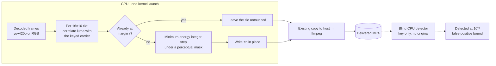

<div align="center">

# FastMark

**An invisible video watermark that costs nothing to embed.**

One CUDA kernel. No model weights. No extra decode or encode.
Marks frames that are already on the GPU, just before they are copied out for encoding.

`~1.6 ms` per 241 frames at 720p &nbsp;·&nbsp; `46.4 dB` PSNR-Y &nbsp;·&nbsp; `100%` detected, `0%` false positives on 100 clips

</div>

---

## Why FastMark

Learned video watermarks such as VideoSeal decode the finished video, run a network over it, and encode it again. For a 5-second clip that adds about 4 seconds to every request. FastMark does the same job differently:

- **It runs in a gap the pipeline already has.** It writes into the decoded frames in GPU memory, in place, right before the existing device-to-host copy. There is no second encode.
- **It has no model.** The mark is a keyed, zero-mean carrier pattern; the embedder works it out with integer arithmetic, and a blind detector finds it with statistics.
- **It changes as little as possible.** Each tile gets the minimum-energy integer change that reaches the detection margin. Tiles already at margin, flat regions, and chroma are never touched.

It answers one question: *was this video generated by us?* It carries no per-request ID. All of the signal goes into presence, so detection holds up better against re-encoding and cropping.

## Results

Measured on 100 MovieGen prompts with MiniMax H3 (768p, 16:9, 5 s). Each prompt was rendered twice with the same seed, once with the mark and once without:

|  | FastMark | VideoSeal |
|---|---|---|
| Detected on delivered MP4s | **100 / 100** | 100 / 100 |
| False positives on unmarked clips | **0 / 100** | 0 / 100 |
| Added request latency (median) | **−0.6 ms** (noise) | +3.98 s |
| PSNR-Y vs. unmarked | **46.4 dB** | 42.9 dB |
| Blind pairwise rating vs. unmarked | **−0.03** [−0.14, +0.06] | −0.30 [−0.47, −0.15] |

- On marked clips, the median false-positive bound was 10⁻¹¹⁴. The strongest score on any unmarked clip was 5.1, far below the threshold.
- Robustness on 20 marked clips: **20/20** survive a CRF 23 re-encode, 11/20 a CRF 28 re-encode, and 15/20 a crop.
- Kernel time on an H100: **1.6 ms** for 241 frames at 720p, **3.6 ms** at 1080p.

## How it works



### The carrier

A secret key drives an HMAC-SHA256 PRF that builds one `512 × 512` int8 carrier, tiled across the frame:

- Each **16 × 16 tile** holds four **8 × 8 cells** with balanced signs, so every tile is zero-mean.
- Each cell is shaped by a smooth raised-cosine bump. Its outer product avoids the sharp block edges that codecs discard and viewers read as a "screen door" texture.
- Every tile is a keyed pilot with a random sign. There is no payload, so all of the energy goes into evidence of presence.

### The embedder

For each tile, with carrier `p` and luma `y`:

```
s   = Σ pᵢ · yᵢ                      exact integer correlation
gap = max(0, τ − s)                  zero → the tile is not written
pick integer steps nᵢ ≥ 0 along sign(pᵢ) minimising Σ nᵢ² / w²ᵢ
    subject to Σ |pᵢ| nᵢ ≥ gap,  nᵢ ≤ min(cap(w²ᵢ), headroomᵢ)
```

- **Perceptual mask:** the weight `w²` and cap come from each 8 × 8 cell's luma variance. Busy texture absorbs larger changes, and flat regions get none.
- **Exact solve:** the problem is a separable convex integer program, solved by bisecting a Lagrange multiplier. At most one change of ±3 luma levels is applied per pixel.
- **Luma only:** in RGB mode the same `n` is added to R, G and B. Because the BT.709 weights sum to 256, Y moves by exactly `n` and Cb/Cr do not change.
- **Kernel layout:** one warp per tile, 32 lanes × 8 pixels. The kernel is compiled at runtime with the `libnvrtc` that PyTorch ships, so it needs no CUDA toolkit. Its output is **bit-identical** to the NumPy reference.

### The detector

The detector needs only the key, never the original:

1. It filters luma with the cell bump. For every tile-grid offset it folds clipped tile votes over the carrier period and over frames into a fixed-size accumulator. That keeps it streaming and constant-memory, and it works on any subset of frames.
2. It scores every offset (crop and translation) at three scales (1.0, 0.75 and 0.5) with two tests that are exact under a random key:
   - **Sign test:** the number of agreeing pilots follows Binomial(K, ½).
   - **Linear statistic:** a Hoeffding bound on `Σ V / √(Σ V²)`.
3. It applies a **union bound** over all `2 · P² · scales` hypotheses. A mark counts as detected only when that bound is at most **10⁻⁹**.

A detection is reported as `attribution_status="mark_only"`. A carrier proves the key was used, not who made the file, and it is never reported as "verified".

## Usage

### Embed on the GPU

```python
from fastmark import production_tables, resolve_key
from fastmark.embed import CudaEmbedder

key = resolve_key()                      # from FASTMARK_SECRET_KEY
marker = CudaEmbedder(production_tables(key), device)  # build once; compiles the kernel

marker.reset_stats()
marker.embed_yuv420p(packed)             # (..., T, H*3//2, W) uint8, contiguous, in place
# or: marker.embed_rgb(frames)           # (N, H, W, 3) uint8, in place
print(marker.read_stats())               # tiles_changed, tiles_short, pixels_changed, sum_sq
```

Build the embedder once per process and call it per request. The kernel is compiled when it is built, and each call is a single launch.

### Detect on the CPU

```python
import av
from fastmark import PRODUCTION_PARAMS, resolve_key
from fastmark.detector import detect_frames

with av.open("clip.mp4") as video:
    luma = [frame.to_ndarray(format="gray") for frame in video.decode(video=0)]

result = detect_frames(luma, resolve_key(), PRODUCTION_PARAMS)
print(result.public())
# e.g. {'watermark_detected': True, 'log10_false_positive_bound': -114.0,
#       'attribution_status': 'mark_only', ...}
```

A handful of frames is enough. On a CRF 23 re-encode of a 5-second clip, 8 frames already give a false-positive bound of 10⁻⁷⁴.

### Reference embedder

`fastmark.reference` is a readable, integer-exact NumPy implementation (`embed_rgb`, `embed_y`). It is the test oracle for the kernel and works without a GPU.

## The key

> [!IMPORTANT]
> The key is read from **`FASTMARK_SECRET_KEY`** and nowhere else. **Never rotate it.** A clip can only be detected with the key that marked it, so rotating the secret makes every earlier clip undetectable.

For the same reason, the production carrier is pinned by a digest test. Any change to the carrier math fails `test_production_carrier_is_pinned`.

## Install

The package is pure Python plus a runtime-compiled kernel, and a checkout root is importable directly.

```bash
pip install "fastmark @ git+https://github.com/fal-ai-community/fastmark.git@<sha>"
pip install "fastmark[cuda]"    # + torch, for the GPU embedder
pip install "fastmark[detect]"  # + opencv, for the CPU detector
```

The fal registry clones a pinned commit at app setup with `GITHUB_FALCOMMUNITY_TOKEN`, because this repository is private and app environment builds have no git credentials. MiniMax H3 Max puts the checkout on `PYTHONPATH` for its GPU ranks, and the `verify` app checks every video for FastMark before trying its other watermark detectors.

## Layout

```
fastmark/
├── __init__.py    PRODUCTION_PARAMS, resolve_key(), production_tables()
├── params.py      FastMarkParams, the keyed carrier tables
├── embed.py       CudaEmbedder: the NVRTC kernel (yuv420p and RGB, in place)
├── reference.py   integer-exact NumPy embedder, the kernel's test oracle
└── detector.py    blind detector: fold accumulator, sign/linear tests, union bound
tests/
└── test_fastmark.py
```

## Tests

```bash
pip install -e ".[test]"
pytest
```

The suite checks the following:
- round-trip detection;
- rejection of a wrong key and of unmarked content;
- chroma neutrality and bounded changes;
- untouched flat frames;
- recovery after a crop;
- nominal-range safety;
- the detector's fold against brute force;
- the key policy;
- the pinned production carrier.

The CUDA kernel was checked bit-exact against the reference on an H100 (yuv420p and RGB, three resolutions, chroma untouched).
